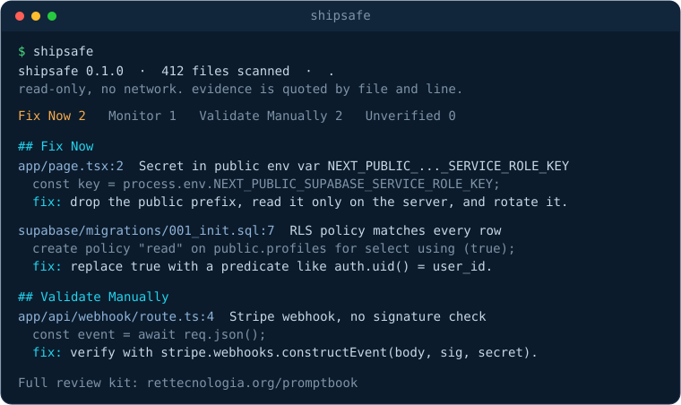

<p align="center">
  <picture>
    <source media="(prefers-color-scheme: dark)" srcset="assets/logo-dark.svg">
    
  </picture>
</p>

<p align="center">
  <strong>Check the hull before you ship.</strong><br>
  A read-only security review for the SaaS you built with an AI agent. Zero dependencies, zero network, evidence by file and line.
</p>

<p align="center">
  
  
  
  <a href="https://crates.io/crates/hullcheck"></a>
  <a href="https://crates.io/crates/hullcheck"></a>
  <a href="https://docs.rs/hullcheck"></a>
  
  <a href="https://github.com/glferreira-devsecops/hullcheck/actions/workflows/ci.yml"></a>
</p>

<p align="center">
  
</p>

---

You shipped a SaaS with a coding agent and you are not sure what went out with it.
`hullcheck` reads the repo and points at the handful of mistakes that actually leak
data or money: a database table anyone can read, a `service_role` key in the browser
bundle, a payment webhook that never checks its signature, TLS verification switched
off, a GitHub Action that runs a stranger's code.

It quotes the exact line behind every finding, and it refuses to call anything a
vulnerability it cannot show you. It reads files only: **no network, no writes, no code
from your repo, and it never tells you your app is secure.**

## Quickstart

```sh
# install (prebuilt binary, verifies its own checksum)
curl -fsSL https://raw.githubusercontent.com/glferreira-devsecops/hullcheck/main/install.sh | sh

# or: cargo install hullcheck

# run it in your project
hullcheck
```

That is the whole setup. No account, no config, no telemetry. It finishes in well
under a second on a typical repo, and exits `1` if there is anything in the Fix Now
lane, so it also works as a CI gate.

## What it catches

Eighteen checks, each one a concrete, high-cost mistake, grouped by where it bites.
Every finding lands in a lane: **Fix Now** (safe to correct today), **Monitor**
(depends on config outside the repo), **Validate Manually** (touches login, data,
money, uploads, admin or AI, so a human confirms), or **Unverified** (the line could
not be confirmed, so it never enters Fix Now).

**Data access**
- `supabase-rls` — a table with no row level security, or a policy with `using (true)`
- `firebase-rules` — a Firestore/Storage/RTDB rule open with `if true` / `true`
- `credential-columns` — a `password` column in a migration (the 2026 Supabase plaintext mistake)
- `prisma-raw-unsafe` — `$queryRawUnsafe` / `$executeRawUnsafe` running interpolated SQL

**Secrets**
- `client-secret` — `service_role`, a Stripe secret key, an AWS key, a private key, or a secret behind a public env prefix, plus provider tokens (GitHub, GitLab, Slack, OpenAI, Anthropic, Google, DigitalOcean)
- `committed-env` — a committed `.env` file (values are redacted, never printed)

**Money**
- `stripe-webhook` — a Stripe webhook handler that never verifies the signature

**Transport & auth**
- `tls-verification-off` — `rejectUnauthorized: false` / `NODE_TLS_REJECT_UNAUTHORIZED=0`
- `jwt-alg-none` — a JWT configured to accept the `none` algorithm
- `cors-wildcard` — CORS open to any origin

**Frontend**
- `dangerous-html` — `dangerouslySetInnerHTML`, the most common AI-generated XSS
- `public-sourcemaps` — production browser source maps left on

**Server config**
- `debug-enabled` — Flask/Django debug mode on

**CI & supply chain**
- `gha-pin` — a GitHub Action pinned to a movable tag instead of a commit SHA
- `gha-pr-target` — a workflow using the `pull_request_target` trigger
- `gha-injection` — a workflow interpolating an attacker-controlled PR title or branch

**Agents & tooling**
- `mcp-hooks` — an MCP server or editor hook that runs a local command
- `agent-doctor` — a `CLAUDE.md` shadowing `AGENTS.md`, a `.md` in `.cursor/rules`, an ignored `.antigravity.md`, a stray `.cursorrules`

This is a sharp set of common mistakes, not a full audit. A clean run means these
checks found nothing, not that there is nothing to find.

## Hand it to your agent

Every report ends with a prompt you can paste straight into your coding agent:

```
For each hullcheck finding, open the quoted file:line, confirm the issue is real,
then propose the smallest safe fix and a test that fails before it. Do not change
anything you cannot confirm from the file.
```

## Usage

```sh
hullcheck [PATH] [OPTIONS]
```

| Option | |
| --- | --- |
| `PATH` | repository to scan (default: current directory) |
| `--json` | emit JSON instead of the human report |
| `--exit-zero` | always exit 0, even with Fix Now findings |
| `-h`, `--help` | print help |
| `-V`, `--version` | print version |

Exit codes: `0` clean (or `--exit-zero`), `1` a Fix Now finding is present, `2` bad usage.

Shell completions live in [`completions/`](completions) (bash, zsh, fish) and a man
page in [`doc/hullcheck.1`](doc/hullcheck.1).

## Ignoring files and lines

hullcheck already skips `node_modules`, `.git`, build output and caches. For the rest,
drop a `.hullcheckignore` at the repo root (gitignore-style: `*`, `**`, `?`, trailing `/`):

```gitignore
vendor/
public/build/**
*.min.js
```

To silence one line, annotate the source:

```ts
const legacyKey = process.env.OLD_KEY; // hullcheck:ignore

// hullcheck:ignore-next-line
const other = buildClient(url, key);
```

## Use it in CI

```yaml
# .github/workflows/hullcheck.yml
name: hullcheck
on: [push, pull_request]
permissions:
  contents: read
jobs:
  scan:
    runs-on: ubuntu-latest
    steps:
      - uses: actions/checkout@fbc6f3992d24b796d5a048ff273f7fcc4a7b6c09 # v5
      - run: cargo install hullcheck
      - run: hullcheck .
```

Use `hullcheck --json .` to feed another tool, or `--exit-zero` to report without
failing the build.

## JSON output

```json
{
  "tool": "hullcheck",
  "version": "0.1.0",
  "scannedFiles": 412,
  "summary": { "fixNow": 2, "monitor": 1, "validate": 2, "unverified": 0 },
  "findings": [
    {
      "rule": "client-secret",
      "lane": "fix-now",
      "title": "Secret exposed through public env var `NEXT_PUBLIC_SUPABASE_SERVICE_ROLE_KEY`",
      "file": "app/page.tsx",
      "line": 2,
      "quote": "const key = process.env.NEXT_PUBLIC_SUPABASE_SERVICE_ROLE_KEY;",
      "impact": "...",
      "fix": "..."
    }
  ]
}
```

## Why it is different

The scanners in this space are known for a wall of findings, half of them wrong.
hullcheck is built against both.

- **Evidence or it does not exist.** Every finding carries `file:line` and the quoted
  line. A signal it cannot confirm goes to the **Unverified** lane, never to Fix Now.
- **Lanes, not a severity lottery.** You always know whether something is safe to fix
  now or needs a human first.
- **Zero dependencies, zero network.** The whole tool is std-only Rust, about 2k lines.
  No package tree can ship a surprise, nothing phones home, and you can audit all of it
  in one sitting. It scans files in parallel and `.env` values are redacted, never printed.
- **It reads the agent, not just the app.** `agent-doctor` tells you which instruction
  file each coding agent actually loads, so the rules you wrote are not silently ignored.

## Not a silver bullet

hullcheck is the fast first pass. For deep SAST, dependency CVEs and secret history, run
[Semgrep](https://semgrep.dev), [osv-scanner](https://github.com/google/osv-scanner) and
[gitleaks](https://github.com/gitleaks/gitleaks) alongside it. When a finding touches
money, access or customer data, a human validates before it is called a vulnerability.

## The full review kit

The repo ships two portable **skills** (`skills/`): tenant isolation and billing
webhooks. Copy them to `.claude/skills/`, `.github/skills/` or `.agents/skills/`, or add
the repo with `npx skills add glferreira-devsecops/hullcheck`.

The [RET Promptbook](https://www.rettecnologia.org/promptbook) goes further: 13 review
skills (auth, uploads, AI and MCP, secrets and supply chain, diff review, threat model,
abuse, LGPD, skill vetting and more), an evidence verifier for Claude Code and Codex,
agent-file paths checked against each tool's official docs, and the full triage flow.

## Credits

The detection patterns are informed by the open rulesets of
[Gitleaks](https://github.com/gitleaks/gitleaks) (provider token prefixes),
[Semgrep](https://semgrep.dev) (insecure transport, JWT) and
[zizmor](https://github.com/woodruffw/zizmor) (GitHub Actions). hullcheck reimplements
the high-signal ideas natively, so it stays dependency-free.

## Contributing

See [CONTRIBUTING.md](CONTRIBUTING.md). A rule is one function in
[`src/rules.rs`](src/rules.rs) with a fixture and a test; no new dependencies. Security
reports: [SECURITY.md](SECURITY.md).

## License

MIT. Use it only on code you own or are authorized to review.

---

<details>
<summary><strong>Português</strong></summary>

`hullcheck` lê o repositório do SaaS que você construiu com um agente de código e aponta
os poucos erros que de fato vazam dado ou dinheiro: tabela que qualquer um lê,
`service_role` no bundle do navegador, webhook do Stripe sem conferir a assinatura,
verificação de TLS desligada, action que roda código de terceiro. Cita a linha exata
atrás de cada achado e não chama de vulnerabilidade nada que não possa te mostrar.

Só lê arquivos: **sem rede, sem escrever nada, sem rodar código do seu repo, e nunca diz
que seu app está seguro.** Valor de `.env` é redigido, nunca impresso.

**Rodar:** `cargo install hullcheck` (ou o `curl | sh` acima), depois `hullcheck` no
projeto. Sai com código `1` quando há achado em *Fix Now*, então serve de gate no CI.

**Faixas:** *Fix Now* (seguro corrigir agora), *Monitor* (depende de config fora do repo),
*Validate Manually* (toca login, dado, cobrança, upload, admin ou IA, humano confirma),
*Unverified* (o que não deu pra confirmar fica fora de Fix Now).

**Ignorar:** `.hullcheckignore` na raiz (padrões estilo gitignore) ou um comentário
`// hullcheck:ignore` na linha (ou `// hullcheck:ignore-next-line` na linha de cima).

São 18 checagens (Supabase/Firebase, segredos e tokens de provedor, Stripe, TLS, JWT,
CORS, XSS, SQL, Actions, MCP e qual arquivo cada agente lê). Zero dependência, tudo em
Rust std. O kit completo (13 skills, verificador de evidência, triagem) está no
[RET Promptbook](https://www.rettecnologia.org/promptbook).

</details>
